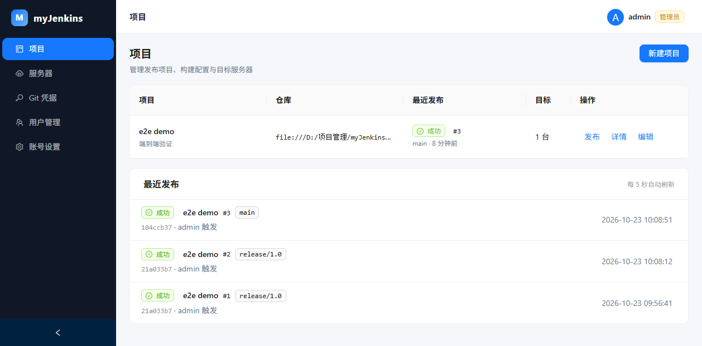
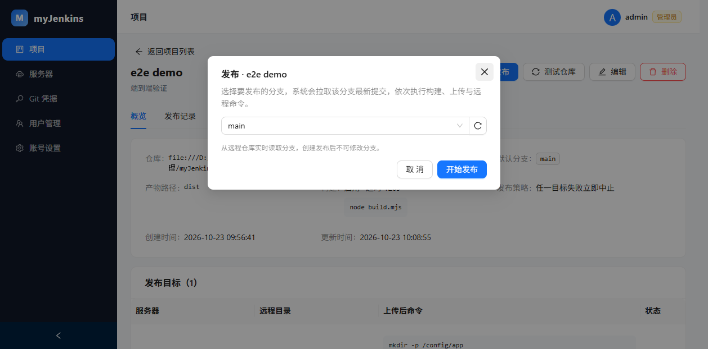
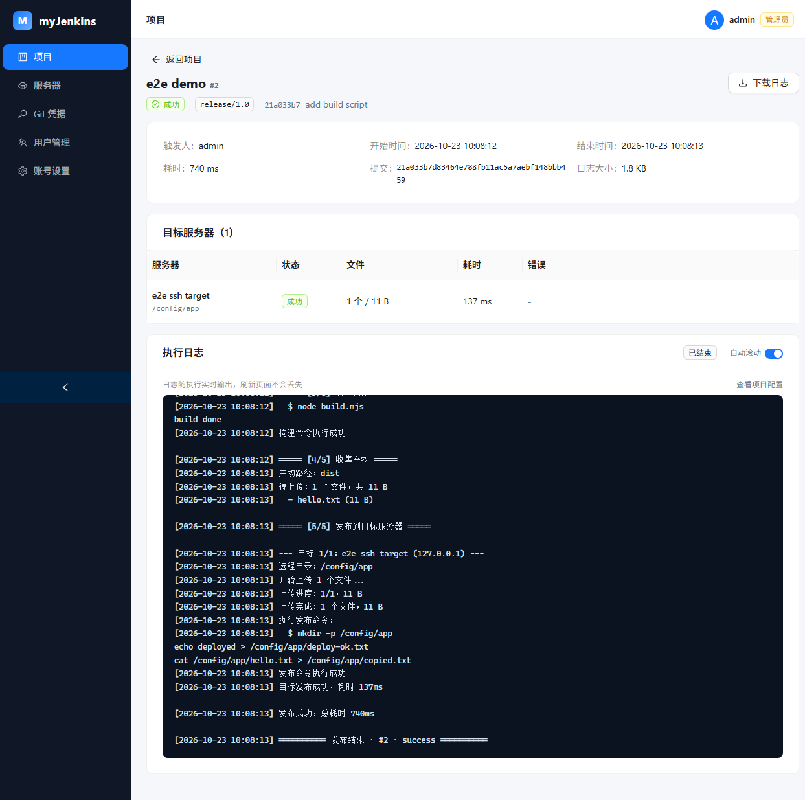

# myJenkins

一个轻量级 CI/CD 发布系统，覆盖 Jenkins 最常用的「选分支 → 拉代码 → 构建 → 上传到服务器 → 执行发布命令」链路。单进程运行、SQLite 存储、一条命令即可用 Docker 部署。



## 功能

- **登录与会话**：管理员/普通成员两种角色；首次启动自动创建管理员；密码使用 scrypt 加盐哈希；登录限流；会话可撤销。
- **项目管理**：一个项目绑定仓库、Git 凭据、构建命令、产物路径、多台发布目标机与发布后命令；支持成员授权、一键复制项目配置（可复制发布目标）与删除。
- **Git 凭据与分支选择**：支持 HTTPS Token 与 SSH 私钥，AES-256-GCM 加密保存且不回显；发布时实时读取远程分支，选择任意分支发布，并记录实际提交 SHA。
- **实时执行日志**：拉取、构建、上传、远程命令的完整输出落盘，页面通过 SSE 实时滚动；断线/刷新不丢历史，日志可下载。
- **跨服务器复制**：产物先打包成 `tar.gz`，通过 SFTP 只传一个压缩包，到目标机后解压并全量覆盖目标目录；日志显示压缩前后大小、上传与解压结果。
- **跨服务器执行命令**：每台目标机可配置发布后脚本，在目标目录下执行；流式回显、超时中断、非零退出码判定失败，可选择「失败即中止」或「继续其余目标」。

## 快速开始（Docker）

前置：Docker 24+、可访问目标机的 SSH（默认 22 端口）。

```bash
cp .env.example .env
# 编辑 .env：至少设置一个足够长的 APP_SECRET；可按需设置 ADMIN_PASSWORD
docker compose up -d --build
```

打开 <http://localhost:8080>。

- 如果设置了 `ADMIN_PASSWORD`，用 `ADMIN_USERNAME` / `ADMIN_PASSWORD` 登录。
- 如果留空，初始密码会在容器日志中打印一次：`docker compose logs myjenkins | grep 初始密码`。

本地联调如果还没有 Linux 目标机，可以额外启动一个 SSH 容器：

```bash
docker compose -f docker-compose.yml -f docker-compose.test.yml up -d
# 目标机地址：127.0.0.1:2222，用户 deploy，密码 deploy-pass-123，目录 /config/app
```

## 使用流程

1. **添加 Git 凭据**（`Git 凭据` 页面）：私有仓库填 HTTPS Token 或 SSH 私钥；公开仓库可跳过。
2. **添加服务器**（`服务器` 页面）：填写 SSH 地址与账号，保存后点「测试连接」，核对返回的主机指纹，再点「信任并保存指纹」。
3. **新建项目**：
   - 仓库地址、Git 凭据、默认分支；
   - 构建命令（在服务所在容器的项目工作区执行，例如 `pnpm install && pnpm build`）与产物路径（目录、单文件或 glob）；
   - 一台或多台发布目标：远程目录 + 上传后执行的命令；
   - 需要时在「成员」页把项目授权给普通成员。
4. **立即发布**：选择分支，系统创建发布记录并依次执行，页面实时展示日志与每台目标的状态。发布中可取消。





## 配置项

所有配置通过环境变量提供（Docker 下写在 `.env`）：

| 变量 | 默认值 | 说明 |
| --- | --- | --- |
| `APP_SECRET` | 空 | 加密 Git Token、密码、私钥的主密钥。留空则自动生成 `data/master.key`。**设置后不要更换**，否则历史凭据无法解密。 |
| `ADMIN_USERNAME` | `admin` | 首次启动创建的管理员用户名（仅在库中没有用户时生效）。 |
| `ADMIN_PASSWORD` | 空 | 管理员初始密码；留空则随机生成并打印到日志。 |
| `PORT` / `HOST` | `8080` / `0.0.0.0` | 服务监听地址。 |
| `DATA_DIR` | `<项目>/data` | SQLite、日志、工作区、主密钥所在目录；Docker 中为 `/data`。 |
| `MAX_CONCURRENCY` | `2` | 同时执行的发布数（1-8），同一项目始终串行。 |
| `LOG_MAX_BYTES` | `52428800` | 单次发布日志上限，超出后停止记录并提示。 |
| `LOG_RETENTION_DAYS` | `90` | 日志与发布记录保留天数，后台每 6 小时清理。 |
| `COOKIE_SECURE` | `false` | HTTPS 部署时设为 `true`。 |
| `TRUST_PROXY` | `false` | 位于反向代理之后时设为 `true`。 |
| `ALLOW_FILE_REPOS` | `false` | 是否允许 `file://` 或本地路径作为仓库，仅供测试。 |
| `ALLOW_INSECURE_GIT` | `false` | 是否允许 `http://` 与 `git://` 仓库（不加密传输，默认关闭）。 |
| `UPLOAD_TIMEOUT_MS` | `1800000` | 单台目标机的产物上传硬超时，超时后断开连接。 |
| `MAX_BUILD_MINUTES` | `240` | 单次发布的硬性时长上限，超时强制终止并释放队列。 |
| `GIT_TIMEOUT_MS` | `120000` | 单次 Git 操作超时。 |
| `SSH_CONNECT_TIMEOUT_MS` | `15000` | SSH 连接超时。 |

## 本地开发

前置：Node.js 24+、pnpm 10、git。

```bash
pnpm install
pnpm --filter @myjenkins/server build   # 编译后端
pnpm --filter @myjenkins/web dev        # 前端 http://127.0.0.1:5173，自动代理 /api 到 8080
```

另一个终端启动后端（首次启动会生成管理员并打印密码）：

```bash
DATA_DIR=./data ADMIN_PASSWORD=admin12345 APP_SECRET=dev-secret \
  node apps/server/dist/index.js
```

生产构建与启动：

```bash
pnpm build
pnpm start
```

测试（74 个用例：认证权限、凭据脱敏、产物收集与路径穿越、Git 克隆、SSH 主机指纹与取消、日志读取、发布取消等）：

```bash
pnpm test
```

## 目录结构

```
apps/
  server/          Fastify API + 发布执行器 + SQLite
    src/
      auth/        登录、会话、权限
      routes/      凭据、服务器、项目、发布、用户
      pipeline/    调度器、执行器、产物收集、日志
      git.ts       git clone / ls-remote 与凭据注入
      ssh.ts       SSH 执行与 SFTP 上传
      db.ts        node:sqlite 访问与建表迁移
  web/             React + Ant Design 管理界面
docs/              架构与部署文档、截图
Dockerfile         多阶段构建，运行镜像内置 git / ssh 客户端
docker-compose.yml 单服务 + 数据卷
```

## 工作方式

每次发布按固定顺序执行：

1. 准备独立工作区 `data/workspaces/p-<项目>/b-<编号>`；
2. 同步仓库缓存：首次按分支浅克隆到 `data/cache/git/p-<项目>.git`，后续只 `git fetch` 增量提交，再用 `git worktree` 检出到工作区，记录提交 SHA 与标题；
3. 在项目目录执行构建命令（可选），实时输出并支持超时终止；
4. 收集产物（目录/文件/glob），校验路径不超出工作区；
5. 逐台服务器：SSH 连接 → 校验主机指纹 → 创建远程目录 → 上传 `tar.gz` 压缩包 → 远程解压全量覆盖 → 执行发布命令。

同一项目串行发布，不同项目可并行（默认上限 2）。发布状态：`queued → running → success / failed / cancelled`；服务重启会把残留的执行中记录标记为失败，排队中的任务重新入队。

## 安全设计

- 密码使用 scrypt（随机盐）；会话 Token 只存 SHA-256，Cookie 为 HttpOnly + SameSite=Lax，改密/禁用立即失效。
- 所有凭据（Git Token、SSH 密码、私钥、口令）使用 AES-256-GCM 加密；接口只返回「是否已设置」，日志输出自动脱敏。
- HTTPS Token 通过 Git 的配置环境变量传递，不进入进程参数列表；SSH 私钥只写入临时目录并在操作后删除。
- SSH 采用「首次人工核对指纹」：未信任的服务器不允许发布；指纹变化时拒绝连接并提示。Git over SSH 使用持久化 `data/git_known_hosts` 记录主机指纹（首次连接自动接受）。
- 仓库地址仅允许 https/ssh 形式（`http://`、`git://` 默认禁用；`file://` 需显式开启），分支名与远程目录做合法性校验，产物路径不能越出工作区。
- 构建命令与发布命令本质上是任意代码执行，仅管理员可配置，并且与服务进程使用同一系统账号。**只应发布可信仓库的代码**，不要把 Token/密码硬编码在构建或发布命令里（它们会展示给项目成员并写入日志）。

## 已知限制（v1）

- 目标机仅支持 Linux（SSH/SFTP）；不支持 Windows 目标机。
- 构建在服务所在容器内执行；需要 Maven/JDK/Python 等工具链时，请通过 `EXTRA_APT_PACKAGES` 或自定义镜像扩展（见部署文档）。
- 单实例 SQLite，不支持多副本；默认同项目串行。
- 暂不支持定时触发、Webhook、Tag/指定 commit 发布、审批、回滚、通知、目标目录原子切换与清理。
- 上传为覆盖/合并语义，不会删除目标目录中多余的历史文件。

## 文档

- [架构设计](docs/ARCHITECTURE.md)
- [部署与运维](docs/DEPLOY.md)
